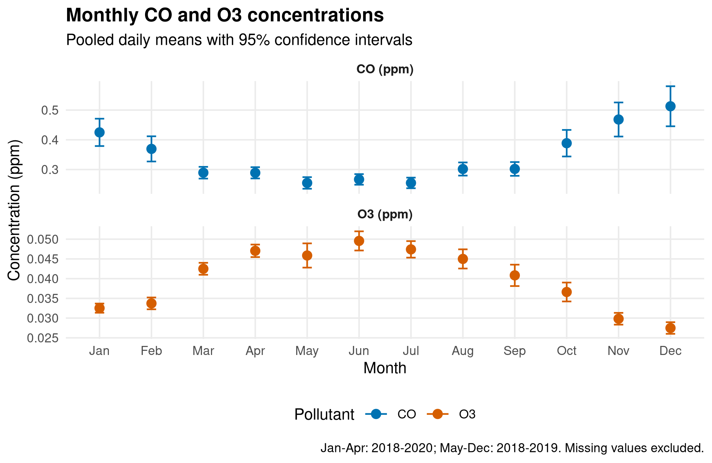
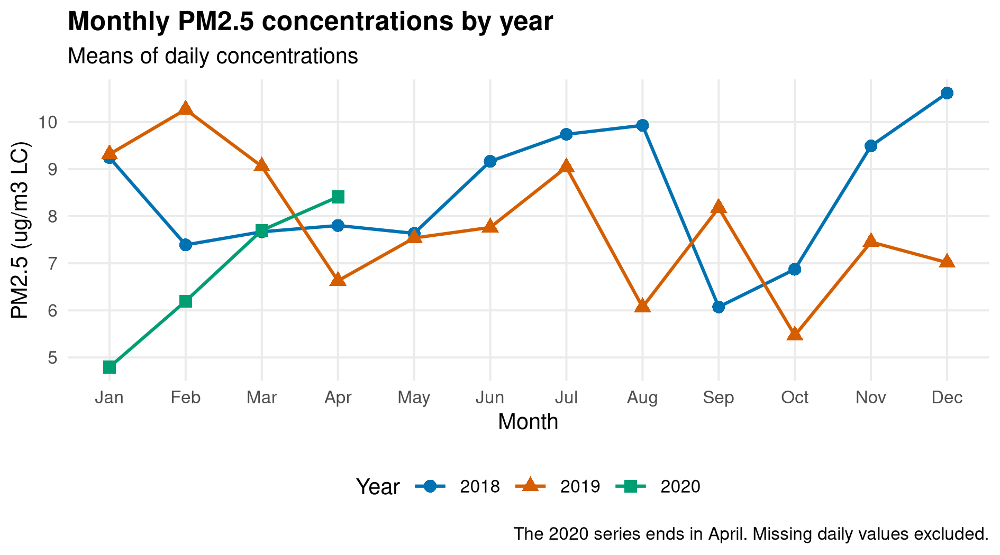

GitHub repository: [BIOSTAT721](https://github.com/leibnitz500-glitch/BIOSTAT721)

# Purpose and data preparation

This project describes daily CO, PM2.5, and O3 measurements from the EPA monitor at RDU airport during 2018, 2019, and January-April 2020. These patterns provide an exposure summary for the proposed study of air pollution and sickle cell disease in Durham County.

I removed identical rows, converted negative measurements to zero, and then averaged the remaining measurements within each day. Removing duplicates first prevents repeated records from receiving extra weight; correcting negatives before averaging prevents a measurement error from lowering the daily mean. Missing measurements remain missing, including four dates absent from the 2018 file, and O3 is reported in ppm unless the function's user requests ppb.

# Daily concentration ranges

Table: Table 1. Daily concentration ranges in 2018.

|Pollutant        | Minimum| Maximum|
|:----------------|-------:|-------:|
|CO (ppm)         |   0.100|   1.000|
|PM2.5 (ug/m3 LC) |   0.000|  20.400|
|O3 (ppm)         |   0.012|   0.067|


Table: Table 2. Daily concentration ranges in 2019.

|Pollutant        | Minimum| Maximum|
|:----------------|-------:|-------:|
|CO (ppm)         |   0.100|   1.300|
|PM2.5 (ug/m3 LC) |   1.400|  21.300|
|O3 (ppm)         |   0.015|   0.068|


Table: Table 3. Daily concentration ranges in January-April 2020.

|Pollutant        | Minimum| Maximum|
|:----------------|-------:|-------:|
|CO (ppm)         |   0.100|   1.000|
|PM2.5 (ug/m3 LC) |   0.300|  31.200|
|O3 (ppm)         |   0.010|   0.052|

```{=openxml}
<w:p><w:r><w:br w:type="page"/></w:r></w:p>
```

# Monthly CO and ozone patterns

<!-- -->

I used separate panels with different y-axis scales because CO concentrations are much larger than O3 concentrations. This makes both seasonal patterns readable while retaining ppm for both pollutants.

For each month, I pooled all available daily values across years and calculated the mean and 95% confidence interval as mean +/- 1.96 x SD / sqrt(n), where n counts non-missing daily values. January-April include three years, while May-December include two.

```{=openxml}
<w:p><w:r><w:br w:type="page"/></w:r></w:p>
```

# PM2.5 by month and year

<!-- -->

I used connected points for monthly means to show changes through the year and make differences between years easy to compare without overlapping daily observations.

# Interpretation

CO was highest in late fall and winter, while O3 was highest in spring and summer, with the pooled O3 mean peaking in June. PM2.5 varied across years rather than following one consistent seasonal pattern: August and December were higher in 2018 than in 2019, and January-February 2020 had lower means than either earlier year despite 2020 having the largest daily PM2.5 maximum (31.200 ug/m3 LC). That contrast shows why a single daily maximum does not describe a typical month; the 2020 comparison covers January-April only, and the pooled May-December estimates use two years instead of three.

# AI use statement

I used AI to help develop the cleaning function, organize the RMarkdown report, and draft the explanations. The code was run on all three input files, and its output was checked against separate calculations for daily averages, annual ranges, and monthly confidence intervals.
